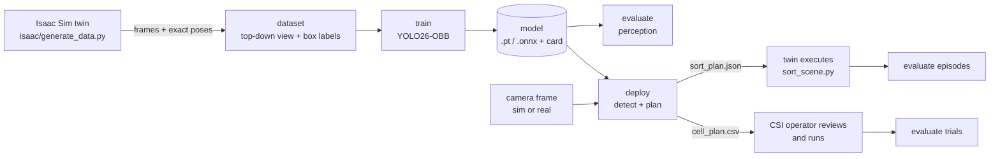

# SmartGrasp

Industrial arms are taught fixed positions, so they cannot pick up parts that end
up somewhere unexpected. SmartGrasp gives the FANUC ER-4iA at UWM's Connected
Systems Institute (CSI) eyes. It trains a small detector **only on synthetic
images from the cell's digital twin**, finds each cube's position and rotation
from one overhead camera frame, and plans top-down grasps that stack the cubes.
The same plan runs in the Isaac Sim twin and becomes a reviewed dry-run target
list for the real cell.

Team project for the Rockwell Automation + NVIDIA Physical AI hackathon, Fall 2026
(Dataset 3: Grasping and Sorting). Event pages are linked [below](#hackathon).

## How it works



**One idea makes the pipeline small.** Every model sees the same kind of image:
a top-down "bird's-eye view" (BEV) of the table at cube-top height, 0.5 mm per
pixel, made by warping the camera frame with a homography.

- A cube's top face is always a 20×20 px square.
- A box's centre *is* the robot XY, and its angle *is* the grasp yaw.
- A sim camera and a real camera differ only in their homography. The sim's comes from the twin; the real one comes from a 30-minute calibration ([docs/CELL_TEST.md](docs/CELL_TEST.md)).

Three detectors share one interface (`smartgrasp/detectors.py`). They are measured by the same evaluator:

| Detector | What it is | Why it is here |
|---|---|---|
| `yolo:<weights>` | YOLO26n-OBB fine-tuned on twin renders | the model we train |
| `hsv` | colour threshold + rotated box, no learning | the baseline to beat |
| `vlm[:<dataset>]` | a vision-language model prompted with instructions and, optionally, worked examples (in-context learning) via build.nvidia.com or self-hosted Cosmos 3 | a no-training comparison |

## Quick start (any laptop, no GPU)

Needs [uv](https://docs.astral.sh/uv/). Python 3.12 is installed automatically.

```bash
uv sync
make test     # lint (Ruff, ty), SmartGrasp pytest + the twin's 33 host tests
make smoke    # whole pipeline on the OpenCV "fake twin": data -> train -> evaluate -> deploy
```

`make smoke` uses `tests/fake_twin.py`, a cartoon renderer that writes the same
files as Isaac. It proves the plumbing in about 35 minutes on an M-series Mac. It
does **not** make a model that sees real cubes: that takes Isaac renders.

## Full pipeline

Setting up Brev or the MSOE GB10: [docs/COMPUTE.md](docs/COMPUTE.md). On the Isaac machine, first set `export ISAAC=/isaac-sim` (the Brev launchable's path; use your install's).

| Step | Command | Where it runs |
|---|---|---|
| 0. Twin materials, once per checkout | `uv run python fanuc_er4ia_sim/make_textures.py` | anywhere, before any Isaac render |
| 1. Synthetic data | `$ISAAC/python.sh isaac/generate_data.py --out data/raw/sim_v1 --frames 3000 --seed 1` | Isaac Sim 6.0.1 with an RTX GPU: Brev launchable, DGX Spark, or the CSI workstation |
| 2. Dataset | `uv run python -m smartgrasp.dataset data/raw/sim_v1 data/bev/sim_v1` | anywhere |
| 3. Train | `uv run python -m smartgrasp.train data/bev/sim_v1 --name sim_v1 --epochs 100` | CUDA (Brev, Spark, Rosie) or `--device mps` on a Mac for small runs |
| 4. Evaluate perception | `uv run python -m smartgrasp.evaluate perception data/bev/sim_v1 --detector yolo:artifacts/models/sim_v1/weights/best.pt` (repeat with `hsv`, `vlm`) | anywhere; `vlm` needs `.env` (copy `.env.example`) |
| 5. Closed-loop sim | `isaac/run_episode.sh 7 runs/episodes/seed7 yolo:artifacts/models/sim_v1/weights/best.pt`, then `uv run python -m smartgrasp.evaluate episodes runs/episodes/*` | Isaac machine with uv |
| 6. Real cell | `calibrate`, then `deploy` on a real frame, then `evaluate trials`; see [docs/CELL_TEST.md](docs/CELL_TEST.md) | laptop at CSI |

Each `deploy` writes:
- `overlay.png`: what was found.
- `sort_plan.json`: the plan in the twin's own format, executed by `fanuc_er4ia_sim/sort_scene.py`.
- `cell_plan.csv`: FANUC UF0/UTOOL1 XYZWPR targets with limit checks, for the operator.

**Headline metrics** (the Dataset 3 judging guidance): first-attempt grasp success, recovery rate after
a failed grasp, and cycle time per pick. All three come from `evaluate trials` (real cell,
logged in [docs/trials_template.csv](docs/trials_template.csv)). `evaluate episodes` (sim) gives
grasp and placement success only:
- The twin's scripted motion takes the same time for every pick, so it has no cycle time to measure.
- Recovery stays empty until ROADMAP task 10 adds retries.
`evaluate perception` adds recall, position and yaw error, and a **graspable rate**:
the share of cubes perceived well enough for the 12 mm gripper to close on them
(`graspable()` in `smartgrasp/evaluate.py`).

## Results

### Isaac twin (Brev L40S, 2026-10-19)

The data is 3,000 Isaac Sim 6.0.1 renders (`--seed 1`): 2,439 train, 310 val and 251 test images. YOLO26n-OBB was trained for 100 epochs (38 min on an L40S). Perception was scored on the test split: 251 images, 1,491 cubes.

| Detector | Recall | Precision | XY error p50 / p95 (mm) | Yaw error p50 / p95 (°) | Graspable | Time / image |
|---|---|---|---|---|---|---|
| `yolo` (Isaac-trained) | **1.000** | **1.000** | **0.16 / 0.37** | 1.58 / 4.75 | **0.993** | 11 ms (L40S) |
| `hsv` (no training) | 0.875 | 0.838 | 2.81 / 3.87 | 3.01 / 14.18 | 0.093 | 9 ms |
| `vlm` Gemma 4 31B, zero-shot, 20 images | 0.967 | 0.983 | 3.09 / 5.76 | 2.94 / 16.73 | 0.091 | ~69 s (hosted) |

Each detector then ran 10 closed-loop episodes in the twin (`isaac/run_episode.sh`, seeds 1-10, the same layouts for both):

| Detector | Towers completed | First-attempt grasp success | Placement success |
|---|---|---|---|
| `yolo` | **9 / 10** | 98.3% | **98.3%** |
| `hsv` | 3 / 10 | 98.0% | 88.2% |

What this shows:
- **Grasping is easy and stacking is hard.** The gripper tolerates a few millimetres when closing on a cube, so both detectors grasp reliably. A six-cube tower does not tolerate that error: HSV's ~3 mm builds up until a placement fails.
- **HSV is biased.** Its colour blob includes the cube's visible side faces, which pulls the centre about 3 mm away from the camera. YOLO learned the top face from exact labels.
- **VLMs find cubes better than HSV but place them no better.** `VlmDetector` refines each box with the same colour blob, so it inherits HSV's position error. See ROADMAP task 8.
- **Hosted VLMs are slow and flaky.** `nvidia/nemotron-3.5-super-vl-120b-a12b` answered only 8 of 20 images: the rest were HTTP 500 server errors. Its answered images looked as accurate as Gemma's. No Qwen3.8 model is hosted on build.nvidia.com.
- **These are sim numbers.** Isaac renders have no printed mat yet (see Known limits). Real-cell numbers come from `evaluate trials`.

### Fake twin (Apple M5 Pro, 2026-10-16)

`make smoke` proves the plumbing on a laptop: 400 OpenCV frames, 30 epochs, 47 test images and 278 cubes. YOLO scored recall 1.000, XY 0.12 / 0.24 mm and graspable 0.996. HSV scored 0.989, 2.43 / 3.35 mm and 0.273. The exported `best.onnx` scored the same as `best.pt`.

## Saving datasets and models

Data and weights never go in git (`.gitignore` covers `data/`, `artifacts/`, `runs/`).
Every dataset carries a `manifest.json` (generator, seed, counts), and every model
carries a `model_card.json` (dataset manifest, training arguments, metrics, git commit).
Share them through a private Hugging Face repo in the team org:

```bash
uvx --from huggingface_hub hf auth login
uvx --from huggingface_hub hf upload <org>/smartgrasp-data data/bev/sim_v1 sim_v1 --repo-type dataset --private
uvx --from huggingface_hub hf upload <org>/smartgrasp-models artifacts/models/sim_v1 sim_v1 --private
```

## Repository layout

```
smartgrasp/          host package, one module per stage (geometry, scene, dataset, detectors, train, evaluate, deploy, calibrate)
isaac/               scripts for Isaac Sim's Python: data generation and closed-loop episodes
tests/               pytest suite and the OpenCV fake twin
docs/                CELL_TEST.md (CSI procedure), ROADMAP.md (team tasks), trials_template.csv
fanuc_er4ia_sim/     the organisers' calibrated twin (see its README); SmartGrasp reads its geometry
```

The twin has three small SmartGrasp patches:
- `CUBE_LAYOUT_SEED` env var for per-episode layouts. It moves the red and blue cubes and all six yaws; the two yellow cubes keep their calibrated positions.
- `capture_scene.py --scale`.
- `sort_scene.py` accepts plans whose `source` is `SmartGrasp`.

## Contributing

`main` should always pass `make test`. GitHub can't enforce this on our plan, so we keep it by habit:

1. Branch from an up-to-date `main`, one branch per change:
   ```bash
   git switch main && git pull && git switch -c <your-name>/<short-topic>
   ```
2. Run `make test` before you push. If you changed a pipeline stage, also run `make smoke` or the Isaac equivalent.
3. Push the branch and open a pull request into `main`. Say what changed and, for experiments, which number moved (ROADMAP: one factor at a time).
4. Get **one approving review** from a teammate or the mentor, then merge. Never push to `main` directly.

Don't commit data, weights, `.env` or keys (see [AGENTS.md](AGENTS.md)).

## Known limits

- **Isaac verified on one machine.** `isaac/generate_data.py` and `run_episode.sh` ran on a Brev L40S with Isaac Sim 6.0.1 on 2026-10-19 ([docs/COMPUTE.md](docs/COMPUTE.md)).
- **Data generation is simplified.** It hides the robot arm and randomizes only object layout and lighting. Camera jitter, materials and lens distortion are ROADMAP task 7.
- **No printed mat in the renders.** The organisers' twin ships "media-free": the scan of the real table mat (`fanuc_er4ia_sim/assets/mat_print.png`) is not included, so Isaac renders show a plain mat. This is the largest known sim-to-real gap. Ask the organisers for the file, or photograph the mat at CSI.
- **Cubes on the table only.** The top-down view is calibrated for cubes on the table. Stacked cubes sit higher and appear shifted, so `deploy` plans nothing while anything is detected near the stack site. Clear the tower before re-capturing.
- **Reach.** `deploy` drops cubes farther than 0.54 m from the robot base: the twin's IK cannot hover top-down beyond that.
- **Cell plan assumptions.** `cell_plan.csv` assumes UTOOL1 = (0, 0, 223, 0, 0, 0) with the fingers closing along tool Y. Confirm both at CSI.
- **Cosmos 3 access.** The hosted Cosmos 3 endpoint on build.nvidia.com returned 404 on 2026-10-16, so `vlm` defaults to Gemma 4 there. Self-host Cosmos3-Nano with vLLM for the Cosmos comparison.
- **Ultralytics licence.** Ultralytics is AGPL-3.0, so trained weights are AGPL too. That is fine for this open academic project. Swap in RF-DETR (Apache-2.0) if a sponsor needs a closed licence.

## Hackathon

- Event guide: <https://msoe-maic.com/library/?article=Rockwell-NVIDIA-Fall-2026>
- Dataset 3 page: <https://msoe-maic.com/library?article=Rockwell-NVIDIA-Fall-2026-Grasping-Sorting>
- Team workspace: <https://dashboard.all-ai-network.org/j/L36HEH>
- Final submission due **Sun Nov 1, 11:59 PM CT** ([submit](https://dashboard.all-ai-network.org/s/V28NHK)): about a 5-minute video, a one-page summary, this repository, references and credits. Finals are Thu Nov 5, MSOE Diercks Hall.

**Credits:**
- FANUC ER-4iA twin and calibration: hackathon organisers (UWM CSI / MSOE AI Club).
- NVIDIA Isaac Sim and build.nvidia.com.
- Ultralytics YOLO26 (AGPL-3.0).
- OpenCV.
